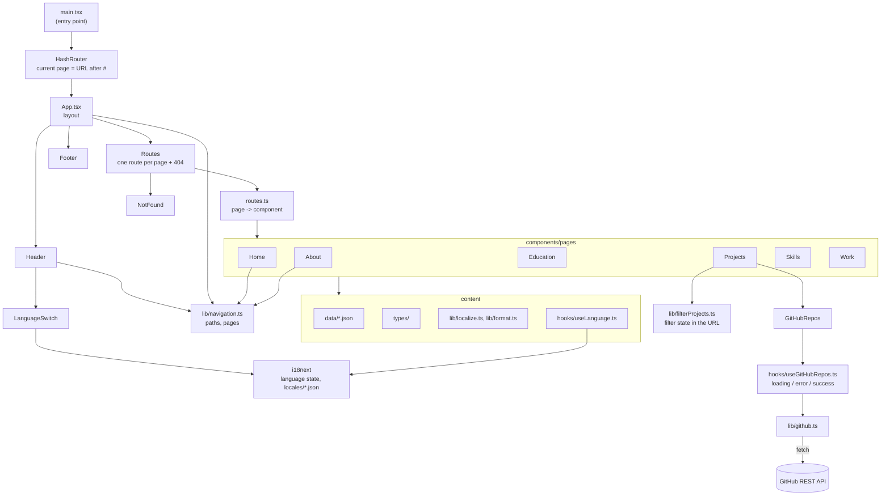
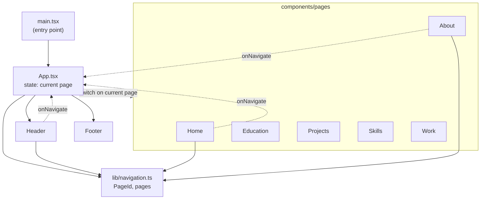

# Christof Schuster - Portfolio


My personal portfolio website, built as part of the SE Evolution course.

Live version: https://christofmitf.github.io/portfolio/

## Contents

- [Method](#method)
- [Personas](#personas)
- [User stories](#user-stories)
- [Requirements](#requirements)
  - [Phase 1](#phase-1)
  - [Phase 2](#phase-2)
  - [Non-functional requirements](#non-functional-requirements)
- [Features](#features)
- [Architecture](#architecture)
- [Project structure](#project-structure)
- [Tools](#tools)
- [Run (local)](#run-local)
- [Tests](#tests)
- [CI/CD](#cicd)
- [Evaluation](#evaluation)
- [Credits](#credits)
- [References](#references)

## Method

The requirements for this site are derived from the people who are going to use it, not from what I thought would look nice. I followed three steps:

1. **Personas:** fictional but specific users with a name, background and goals, so the design stays focused on real visitors instead of on myself (Pruitt & Grudin, 2003).
2. **Scenarios:** one realistic example per persona of how they would use the site (Sommerville, 2016).
3. **User stories and requirements:** the scenarios are broken down into user stories in the usual "As a …, I want …, so that …" form (Cohn, 2004). Each requirement then points back to the stories or the feedback it comes from and has an acceptance criterion, so it can be checked whether it's met.

Phase 1 was evaluated by a peer review and by the lecturer. Their feedback is the second source for the Phase 2 requirements.

## Personas

These two personas are who the site is mainly built for. They are made up, but based on the people who would actually look at my portfolio when I apply for jobs from summer 2027, and on my own experience applying for working student positions.

### Rosa, recruiter

Rosa is 34 and works in HR at a mid-sized software company in Stuttgart. She looks through dozens of applications a week and isn't a developer herself. A portfolio link is usually something she opens between two calls, maybe on her phone. Most applications she gets are in German, and while she reads English fine, she's faster in German and prefers it for things like dates and job titles.

She doesn't read everything. She wants to know within a minute what degree I have, when I finish, whether I have real work experience, and how to contact me. If she has to search for this, she closes the tab.

**Scenario:** Rosa gets my application for a junior developer position starting summer 2027. She opens the portfolio from the CV on her phone. The site opens in German because her browser is set to German. On the home page she sees my degree, and one tap on the education card shows that I graduate in summer 2027. She taps through to Work to check that the working student job was actually software development, and then uses the contact button to send me an email asking for an interview.

### Zohran, technical hiring engineer

Zohran is a senior developer and team lead in an international team that works in English. He lives in Germany, so his browser is set to German, but he prefers reading anything technical in English. He does the technical interviews in his team, gets the shortlist from HR and prepares the interview the evening before, on his laptop.

He's less interested in grades and more in what I've actually built and how. He wants to see projects with a short explanation, which languages and tools I really used, and ideally the code on GitHub. He also notices if a site is slow, broken on mobile, or obviously built from a template without understanding it. Since the portfolio itself is a piece of my work, he looks at how it's built too: whether the code is structured and readable, and whether there are things like tests and a build pipeline.

**Scenario:** Zohran has my CV and an interview with me the next day. He opens the portfolio on his laptop. It opens in German, so he switches it to English with the button in the header and goes straight to Projects. He filters for university projects, reads about the darts app and my thesis, and follows the link to the GitHub repo to see how the code looks. On the Skills page he checks how confident I am in Python and Java, and he writes down two questions about the thesis for the interview. Before closing the tab, he opens the repository of the portfolio itself, skims the README and the folder structure and sees that the build pipeline is green.

## User stories

From Rosa's point of view:

- **US1** As a recruiter, I want to see my candidate's degree on the first page and when they're available within one click, so that I can decide quickly if they fit the position.
- **US2** As a recruiter, I want to see previous jobs with dates and what was done there, so that I can check if it was real software work.
- **US3** As a recruiter, I want to contact the candidate with one click, so that I don't have to look for an email address.
- **US4** As a recruiter, I want to read the site in German, so that I can go through it faster.
- **US5** As a recruiter, I want the site to work on my phone, so that I can check it between calls.

From Zohran's point of view:

- **US6** As a hiring engineer, I want to see projects with a short explanation and the technologies used, so that I know what the candidate has actually built.
- **US7** As a hiring engineer, I want to search and filter the projects, so that I find the relevant ones without reading everything.
- **US8** As a hiring engineer, I want links to the code on GitHub, so that I can see how the candidate writes code.
- **US9** As a hiring engineer, I want to see how confident the candidate is with each language and tool, so that I can prepare the right interview questions.
- **US10** As a hiring engineer, I want to send a link to a specific page to a colleague, so that they land on the same page I'm looking at.
- **US11** As a hiring engineer, I want the site to load fast and work without errors, so that I get the impression the candidate cares about quality.
- **US12** As a hiring engineer, I want to switch the site to English myself, so that I can read it in my working language even though my browser is set to German.
- **US13** As a hiring engineer, I want to see how the portfolio itself is built (code structure, comments, tests, pipeline), so that I can judge the candidate's code quality on a real example.

## Requirements

Each requirement comes either from one of the user stories above or from the feedback I got on Phase 1. The "Done when" column is the acceptance criterion I check it against.

Phase 1 was about getting all the content online in a clean, simple layout. Phase 2 is about what the personas need beyond that (projects, language, sharing links, working on phones) and about the feedback on Phase 1, which mostly concerned documentation, code structure and a more dynamic site.

### Phase 1

Phase 1 was the first version of the site, built from scratch with React and TypeScript. Everything here is done.

| ID | Requirement | From | Done when |
|---|---|---|---|
| P1-1 | Home page with degree and current status, plus links to the other pages | US1 | Degree, university and current status are visible without scrolling on a laptop screen |
| P1-2 | Work page with all jobs, dates and tasks | US2 | Every software job shows role, company, period and its tasks, other jobs are listed with role, company and period |
| P1-3 | Education page with degrees, grades, thesis and selected modules | US1 | Every degree shows institution, period and grade (or "ongoing") |
| P1-4 | Skills page with a level for each programming language | US9 | Every language has a level from 1 to 5 |
| P1-5 | Email button and footer links to GitHub and LinkedIn | US3, US8 | Email opens with one click, GitHub and LinkedIn open in a new tab |
| P1-6 | About page with a short bio and interests | US1 | Bio, interests and a contact button are on the page |
| P1-7 | Header navigation that is the same on every page | all | Every page is reachable from every other page in one click, and the current page is highlighted |

### Phase 2

Phase 2 builds on that and adds what was missing.

| ID | Requirement | From | Done when | Status |
|---|---|---|---|---|
| P2-1 | Site is live on GitHub Pages and deployed automatically on every push | US11, US13 | A push to `main` updates the live site without manual steps, and a failing lint or build stops the deploy | done |
| P2-2 | German and English version, chosen by browser language, with a switch in the header | US4, US12 | With a German browser the site opens in German, otherwise in English. The switch changes all texts and dates, and the choice is still there after a reload | done |
| P2-3 | Every page has its own URL, so refreshing and shared links work | US10, peer review | Reloading any page stays on that page, a copied link opens the same page, and an unknown URL shows a "not found" page | done |
| P2-4 | Projects page with a short description, technologies and links for each project | US6, US8, peer review | At least 4 projects, each with description, technologies and a link (repository or more info) where one exists | done (descriptions to be refined) |
| P2-5 | Search and filter on the Projects page | US7 | Typing a word or picking a tag only shows matching projects, and a message appears if nothing matches | done |
| P2-6 | Public GitHub repositories loaded through the GitHub API | US8 | Repositories are loaded on page visit, and a loading and an error message are shown when needed | done |
| P2-7 | Layout and navigation work on phones | US5 | All pages are usable at 360 px width (see NFR-1) | done |
| P2-8 | Pages and images are only loaded when needed | US11 | Each page is its own JavaScript chunk in the build, and images below the fold use lazy loading | done |
| P2-9 | Content (jobs, education, skills, projects) stored in JSON files instead of inside the components | maintainability | Changing a job or project only means editing a JSON file, no component code | done |
| P2-10 | Animations to make the site feel less static | peer review | The content of a page animates in when the page opens, and animations are turned off with "reduce motion" (changed from scroll animations, which were dropped to keep it simple) | done |
| P2-11 | Code explained with comments and JSDoc headers | US13, lecturer feedback | Every component and data file starts with a JSDoc header, and non-obvious logic has a comment | done |
| P2-12 | Code formatter and automated tests, both checked in the pipeline | US13 | The pipeline fails if the code isn't formatted or a test fails | done |
| P2-13 | Availability from summer 2027 shown on the home page (so far it's only on About) | US1 | "Available from summer 2027" is visible without scrolling on the home page | dropped: the date is already on Education (one tap from Home) and About, and recruiters come from a CV that states it too. A third copy would only be one more place to keep up to date |

### Non-functional requirements

| ID | Requirement | From | Measured by |
|---|---|---|---|
| NFR-1 | Responsive layout: two-column layouts stack below 768 px, and there is no horizontal scrolling down to 360 px width | US5 | Browser dev tools at 360, 768 and 1280 px |
| NFR-2 | Performance: Lighthouse performance score of at least 90 on mobile | US11 | Lighthouse in Chrome |
| NFR-3 | Accessibility: Lighthouse accessibility score of at least 90, every link and button reachable with the keyboard and with a visible focus | US5, US11 | Lighthouse and a run through with only the keyboard |
| NFR-4 | Image size: no single image above 300 KB | US5, US11 | Build output |
| NFR-5 | Maintainability: no lint errors, no type errors with strict TypeScript, no repeated markup that could be generated from data | US13 | oxlint and `tsc` in the pipeline, code inspection |
| NFR-6 | Browser support: works in the current versions of Chrome, Firefox, Edge and Safari | US5, US11 | Manual check |

## Features

**Phase 1**
- Six pages: Home, About Me, Education, Projects (placeholder), Skills and Work
- Header navigation with the current page highlighted, footer with links and contact
- Overview cards on the home page that link to Work, Education and Skills
- Light and dark colours that follow the system setting

**Phase 2**
- Automatic build and deployment with GitHub Actions (lint, format check, tests, build), live on GitHub Pages
- German and English version, chosen by browser language, with a switch in the header
- Own URL for every page, including the current project filter
- Projects page with search and filters, plus my public repositories loaded from the GitHub API
- Content in JSON files, lazy loaded pages, a short page fade-in with GSAP
- Menu button on small screens, visible keyboard focus and a skip link
- Header comments in every file, Prettier and tests with Vitest

## Architecture

I made both diagrams by following the imports and props from the entry point `main.tsx` through `App.tsx` into every component, so they match the code. Solid arrows mean "renders" or "imports". CSS files and images are left out to keep them readable.

### Current (Phase 2)



The current page is now part of the URL (`#/work`) instead of React state. Header, Home and About use `Link`/`NavLink` from React Router to change it, and `App` only decides the layout. Work, Education, Skills and Projects render their content from the JSON files in `data/`. The language lives in i18next, so the switch in the header changes every page at once. The Projects page keeps its filter in the URL and loads my public repositories live from the GitHub API.

### End of Phase 1



Dotted arrows are callbacks that send a page change back up to `App`. `App` kept the current page in React state and decided which page component to render. Because the page wasn't in the URL, a reload always went back to Home, which P2-3 fixed.

## Project structure

```text
src/
  main.tsx            entry point, mounts App inside the HashRouter
  App.tsx             layout: Header, the route for the current URL and Footer
  routes.ts           which component belongs to which page, pages are lazy loaded
  App.css             layout of the main area
  index.css           global styles, colours and shared button styles
  components/
    Header.tsx        navigation bar, collapses into a menu button below 900 px
    Footer.tsx        links and copyright
    LanguageSwitch.tsx  EN/DE buttons in the header
    GitHubRepos.tsx   public repositories from the GitHub API, shown on Projects
    FadeIn.tsx        GSAP fade-in of a page when it opens
    pages/            one component per page (plus NotFound), each with its own CSS file
  data/               content as JSON (work, education, skills, projects), texts in English and German
    data.test.ts      checks the content: unique ids, valid dates, complete translations
  locales/            UI texts (headings, buttons, navigation) as en.json and de.json
  i18n.ts             i18next setup: language detection, saving the choice, <html lang>
  types/              TypeScript types for the data, checked when the JSON is imported
  lib/
    navigation.ts     URL paths of the pages and their labels in the header
    localize.ts       picks the right language from a translated text
    format.ts         dates and grades per language with the Intl API
    filterProjects.ts search and filter logic of the Projects page
    github.ts         loads the repositories from the GitHub API
    *.test.ts         unit tests next to the file they test
  hooks/
    useLanguage.ts    current language and a function to change it
    useGitHubRepos.ts loading, error or loaded repositories
  assets/             images that are imported in the code
public/               files served as they are (favicon)
e2e/                  browser walkthrough of the persona scenarios with Playwright
scripts/lighthouse.mjs  Lighthouse scores for Home and Projects, mobile and desktop
.github/workflows/    CI/CD pipeline
```

## Tools

| Tool | Used for | Why |
|---|---|---|
| React | UI components | Most widely used UI library and the one used in the course. Components make it easy to reuse parts like the header and cards |
| TypeScript | Type checking | Catches mistakes like a wrong prop or a missing field before the site runs. Coming from Python and Java, I prefer having types |
| Vite | Dev server and build | Fast hot reload and a ready `react-ts` template. Create React App, the old default, is deprecated, and the React docs name Vite as an option for starting from scratch |
| oxlint | Linting | Comes with the Vite template and is much faster than ESLint |
| Prettier | Formatting | Formats all code the same way, so I don't have to think about quotes or spacing and diffs only show real changes. Set to single quotes and no semicolons, like the Vite template |
| GitHub Actions | CI/CD | Runs directly where the code is, free for public repositories |
| GitHub Pages | Hosting | Free static hosting that works together with Actions |
| i18next + react-i18next | Translations | The most widely used i18n library for React. Detects the browser language, remembers the choice and checks the translation keys with TypeScript |
| lucide-react | Icons | Came with the setup I started from. Icons are separate React components, so only the ones I use (menu and close) end up in the build |
| GSAP + @gsap/react | Animations | Kept simple on purpose: when a page opens, its parts fade and slide in one after another. `useGSAP` cleans the animation up when the page changes, and `gsap.matchMedia` turns it off for visitors who set "reduce motion" on their device |
| Vitest | Tests | Made by the Vite team and uses the same config, so TypeScript and JSON imports work in tests without extra setup. The API (`describe`, `it`, `expect`) is the same as Jest's |
| Playwright | Browser tests | Clicks through the site in a real browser like a visitor would, so the persona walkthrough can be repeated after every change instead of by hand. Runs in the installed Edge, so no extra browser download |
| Lighthouse | Evaluation | The standard tool for performance and accessibility scores, and the one named in NFR-2 and NFR-3. Run from a script so the measurement is the same every time |
| React Router | Navigation | Gives every page its own URL. I use the `HashRouter` (`#/work`), because GitHub Pages only serves static files and would answer a reload of `/portfolio/work` with a 404 |

## Run (local)

Requires [Node.js](https://nodejs.org/).

```bash
npm install
npm run dev
```

Then open the URL shown in the terminal.

Other scripts:

```bash
npm run lint          # oxlint
npm run format        # format all files with Prettier
npm run format:check  # only check, used in CI
npm test              # run all tests once
npx vitest            # run tests again on every change
npm run test:e2e      # browser walkthrough with Playwright (see Tests)
npm run lighthouse    # Lighthouse scores of the live site (see Evaluation)
npm run build         # type check and production build
```

## Tests

Unit and content tests use [Vitest](https://vitest.dev/) and sit next to the file they test (`format.ts` and `format.test.ts`). There are two kinds:

- **Unit tests** for the functions in `src/lib`: date periods and grades in both languages, picking the right language, and the project search and filter. They don't need React, because these functions only take input and return output. The filter tests use small made-up projects, so they don't break whenever I change the real content.
- **Content tests** (`src/data/data.test.ts`) for the JSON files. TypeScript checks that every field exists and has the right type, but not that the values make sense. These tests check that ids are unique, dates are real months and don't end before they start, every text exists in English and German, no `DE_` placeholder is left, projects have a known category and links use https.

To check that the content tests really catch mistakes, I broke `projects.json` on purpose (a duplicate id, the month `2026-13`, a `DE_` placeholder, an unknown category and an `http` link). Each change made exactly the matching test fail.

### Browser walkthrough (Playwright)

[e2e/walkthrough.spec.ts](e2e/walkthrough.spec.ts) plays through the scenarios of both personas in a real browser and checks the user stories along the way:

- **Rosa:** German browser on a 390 × 844 phone. The site opens in German, the degree is visible without scrolling, she gets to Education and Work through the menu, and the email link works.
- **Zohran:** German browser on a 1280 × 800 laptop. He switches to English, searches and filters the projects, opens the same filtered link as a colleague would, and checks the skill levels.
- **NFR-1:** every page at 360, 768 and 1280 px in both languages, checking that nothing scrolls sideways.

Run it with:

```bash
npm run test:e2e
```

This builds the site, starts `vite preview` and runs the tests in Microsoft Edge, so they test the same files that get deployed. Other useful commands:

```bash
npx playwright test --ui        # window where you can run single tests and watch every step
npx playwright test --headed    # shows the browser while the tests run
npx playwright show-report      # opens the report of the last run, with screenshots of failures
```

Edge is used because it's already installed on Windows. Without Edge, run `npx playwright install chromium` and remove the `channel` line in [playwright.config.ts](playwright.config.ts).

The walkthrough is not part of the CI pipeline yet. It runs locally before a push.

## CI/CD

The site is built and deployed with GitHub Actions ([deploy.yml](.github/workflows/deploy.yml)). The workflow runs on every push to `main` and can also be started by hand from the Actions tab.

Steps:

1. `npm ci` installs the exact versions from `package-lock.json`
2. `npm run lint` runs oxlint
3. `npm run format:check` checks that all files are formatted with Prettier
4. `npm test` runs all tests with Vitest
5. `npm run build` type checks with `tsc` and builds the site with Vite
6. the `dist` folder gets uploaded and deployed to GitHub Pages

If linting, the format check, a test or the build fails, nothing is deployed, so the live site always stays on the last working version.

The actions are pinned to commit hashes instead of tags like `@v4`, so the pipeline only changes when I update it myself. Because the site lives under `/portfolio/` and not at the root, `base` is set to `/portfolio/` in `vite.config.ts`, otherwise the CSS, JS and images wouldn't load.

## Evaluation

The finished site was evaluated in three ways (details in the report):

- **Code inspection:** a checklist review based on Fagan (1976), with the same criteria I used for reviewing another student's portfolio in Phase 1, plus checks for the Phase 2 features.
- **Walkthrough:** both personas went through their scenarios on the built site, automated with Playwright in Edge (`npm run test:e2e`, see [Tests](#tests)), and every user story was marked as met or not.
- **Lighthouse** (mobile and desktop) on Home and Projects for the non-functional requirements (`npm run lighthouse`, see below). The values before the fixes come from version 12, the values after from version 13, so they aren't strictly comparable.

Results for the non-functional requirements after fixing what the evaluation found:

| ID | Result |
|---|---|
| NFR-1 | Met: no horizontal scrolling on any page at 360, 768 and 1280 px, in both languages (checked by `npm run test:e2e`) |
| NFR-2 | Met, with little margin: mobile performance 97 on Home and Projects (was 55 and 74), desktop 100, measured on the live site. Mobile scores vary between runs, another run gave 88 for Home |
| NFR-3 | Met: accessibility 100 (was 96), keyboard run through passed |
| NFR-4 | Met: largest image 58 KB |
| NFR-5 | Met: no lint or type errors, content rendered from data |
| NFR-6 | Partly checked: tested in Edge (Chromium) only |

### Repeating the Lighthouse measurement

[Lighthouse](https://developer.chrome.com/docs/lighthouse/overview) is Google's tool for checking a web page. It loads the page in a browser and gives scores from 0 to 100 for performance, accessibility, best practices and SEO, together with a list of what to fix. The mobile preset simulates a slow phone on a slow network, the desktop preset a normal laptop.

[scripts/lighthouse.mjs](scripts/lighthouse.mjs) runs it on Home and Projects with both presets and prints a table:

```bash
npm run lighthouse                                       # live site
npm run preview                                          # or: local build, in a second terminal
npm run lighthouse -- http://localhost:4173/portfolio/
```

The full reports, with every finding explained, are saved as HTML files in `lighthouse-reports/`. The same check also works without the script: open the site in Chrome or Edge, press F12 and pick the Lighthouse tab, or use [PageSpeed Insights](https://pagespeed.web.dev/), which measures on Google's servers.

The scores, mostly performance, change by a few points between runs, because they depend on the computer and the network.

## Credits

- Started from the official [Vite](https://vite.dev/) `react-ts` template (React + TypeScript).
- Structure and ideas inspired by [Salim Saay's portfolio](https://github.com/saaysalim/Salim-Saay).
- The workflow is based on the GitHub Pages example from the [Vite docs](https://vite.dev/guide/static-deploy#github-pages).

## References

Cohn, M. (2004). *User stories applied: For agile software development*. Addison-Wesley.

Pruitt, J., & Grudin, J. (2003). Personas: Practice and theory. In *Proceedings of the 2003 Conference on Designing for User Experiences* (pp. 1–15). ACM. https://doi.org/10.1145/997078.997089

Sommerville, I. (2016). *Software engineering* (10th ed.). Pearson.
